<picture>
  <source media="(prefers-color-scheme: dark)" srcset="assets/banner-dark.svg">
  
</picture>

I build infrastructure the way good software is built: versioned, tested, and shipped through a pipeline that refuses anything unsigned. Mostly Go and Python, on Kubernetes, with OpenTofu and Ansible underneath.

[d1srupt3d.dev](https://d1srupt3d.dev) &nbsp;·&nbsp; [LinkedIn](https://linkedin.com/in/liamgamache)

### Selected work

<table>
<tr>
<td width="50%" valign="top">

#### [strata](https://github.com/D1srupt3d/strata)

Layered dotfiles manager for macOS, Linux and Windows.

It remembers what it last wrote, so it can tell your local edits from upstream changes and never overwrites either. CI runs on all three operating systems with the race detector and govulncheck, and the installer verifies each release's SSH signature before anything lands.

Go · GoReleaser · Homebrew tap

</td>
<td width="50%" valign="top">

#### [skyledger](https://github.com/D1srupt3d/skyledger)

Long-term archive for an ADS-B aircraft receiver.

It decodes the receiver's binary history and live feed into TimescaleDB with exactly-once imports, then derives flights, range and signal health. CI runs integration tests against a real database with an 80% coverage gate and installs the Helm chart into a throwaway kind cluster.

Go · TimescaleDB · Grafana · Helm · amd64 + arm64

</td>
</tr>
</table>

### Homelab

A private, production-style platform: Proxmox and OPNsense underneath, three Kubernetes clusters on top, all of it in one repository.

| Practice | How it works |
|---|---|
| **Change control** | Merging deploys nothing. Argo CD and Semaphore act only on a GPG-signed approval commit, and fail closed otherwise. |
| **Secrets** | 1Password is the only source. External Secrets delivers them at runtime; gitleaks guards every commit. |
| **Network** | Default deny. Every app gets an explicit Cilium policy. |
| **Recovery** | Each guest's backup tier is a tag in OpenTofu. Restore drills for etcd and the management cluster are in progress. |
| **Clusters** | `cygnus` K3s for apps · `lyra` five self-healing Talos nodes built by Omni · `vega` management, running Omni and Argo CD |

Proxmox · OPNsense · TrueNAS · OpenTofu · Ansible · Packer · K3s · Talos · Omni · Argo CD · Cilium · External Secrets · CloudNativePG · Prometheus · Grafana · Loki

**Now:** moving workloads onto `lyra`, running restore drills, and learning Rust.

---

Also answers to the Great Disk Druid.
